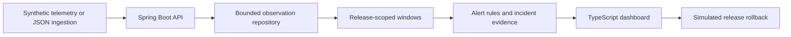

# AI Observability Platform

Investigate a synthetic regression in an LLM agent alongside a healthy classifier. The TypeScript dashboard shows success rate, p95 latency, cost, input drift and prediction drift. Open the incident to inspect the exact observations that triggered it, then simulate switching traffic back to the stable model and prompt versions.

## Run locally

Requires Java 21, Maven, Node.js and npm.

```sh
npx --yes --package typescript@5.9.3 tsc dashboard/dashboard.ts --strict --target ES2020 --outDir src/main/resources/static
mvn package
java -jar target/ai-observability-platform-0.1.0.jar
```

Visit http://localhost:8080. Expand the support-agent incident and select **Simulate rollback**. The service overview will switch to the stable release's retained observations. Start a new process to reset the demo.

## Architecture



Observations carry a trace ID, model and prompt versions, latency, cost in microdollars, success and two normalized drift signals. The repository deduplicates retained observation IDs. Alerts compare 12 recent observations per release in ingestion order. Drift uses total variation distance between normalized ten-bin histograms. Each incident retains the triggering window for inspection. Ingestion creates an OpenTelemetry span through the global API. Exporting those spans requires an SDK or Java agent.

- `GET /api/health` and `GET /api/overview`
- `GET /api/incidents` and `GET /api/incidents/{id}`
- `POST /api/incidents/{id}/rollback`
- `POST /api/observations` accepts the typed JSON observation contract in Monitor.java.

## Cloud deployment

Build the dashboard and JAR using the commands above. Run the JAR on a Java 21 host with one replica, `OBSERVE_BIND=0.0.0.0` and the platform-assigned `PORT`. Use `/api/health` as the health probe. Keep the demo behind private ingress because the endpoints assume trusted callers. Durable storage, authenticated mutation endpoints and actual deployment automation are integration points.

All bundled telemetry is synthetic. The rollback changes the demo's in-memory active release. The repository makes no measured throughput or alert precision claims.
